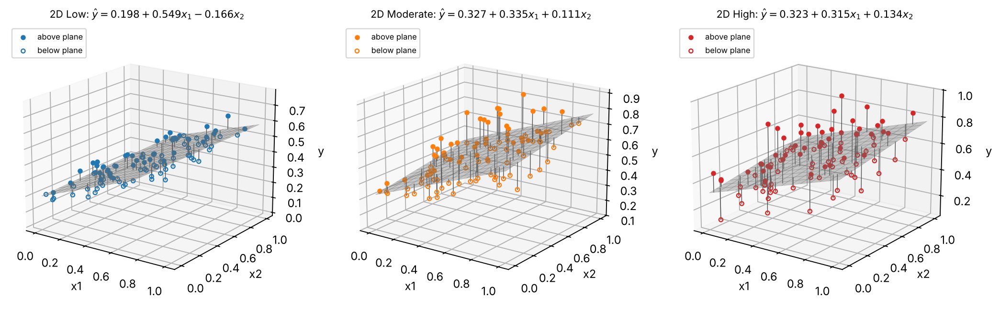
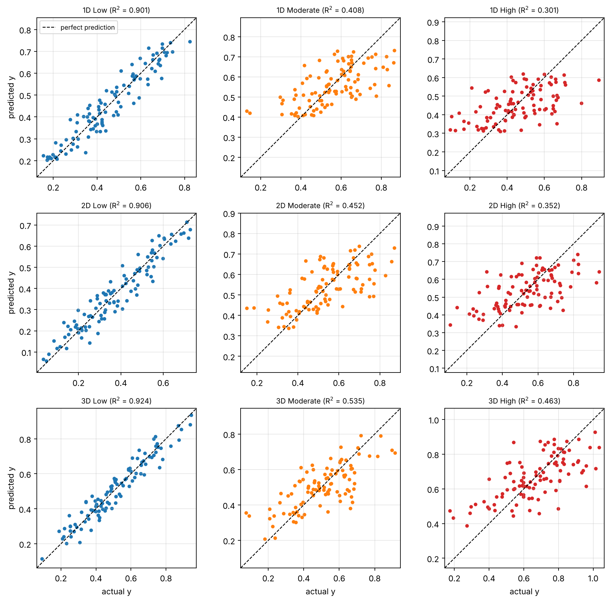
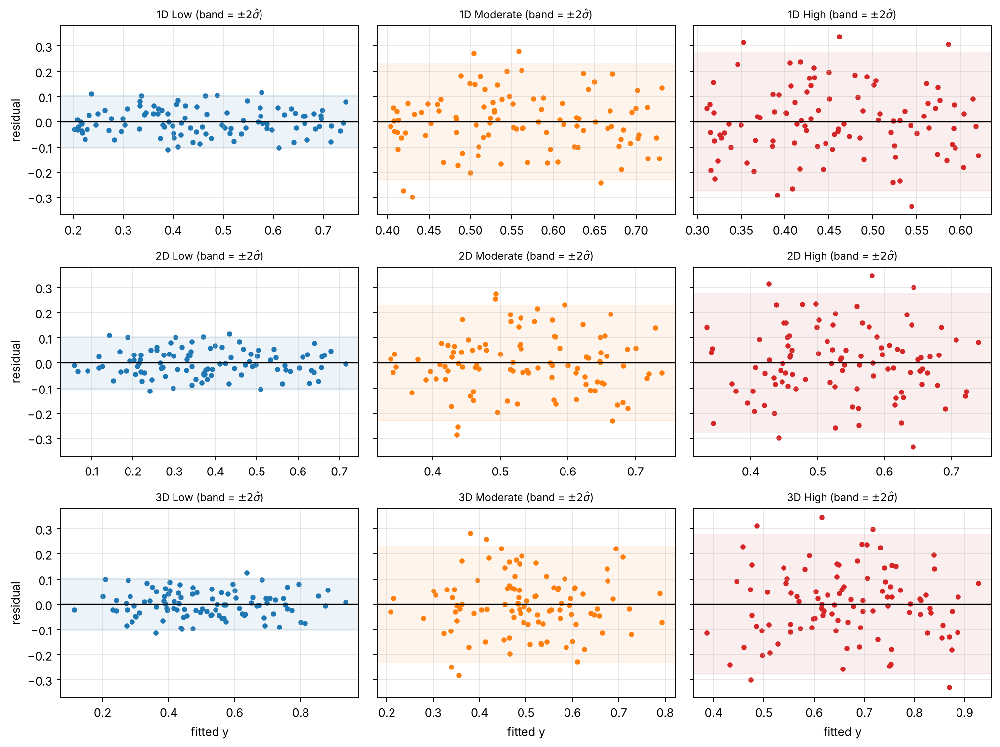
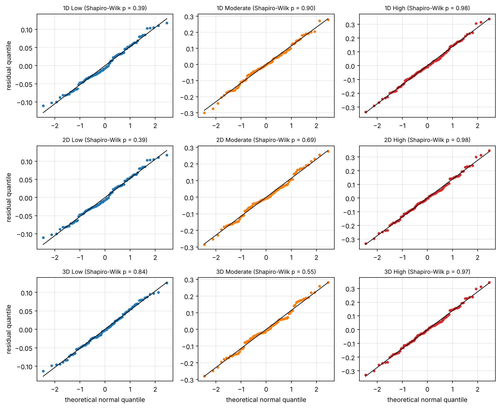
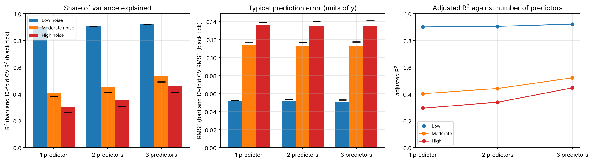

# Simple and Multiple Linear Regression, from Scratch (NumPy)

Ordinary least squares regression with full statistical inference, implemented from first principles in NumPy (QR decomposition), and verified against `numpy.linalg.lstsq` and scikit-learn. Built for CS 4033/5033 Machine Learning Fundamentals at the University of Oklahoma (Fall 2026).



## Highlights

* `OLSRegression` class solved by QR decomposition, not the normal equations
* Coefficient standard errors, t tests, p values and 95% confidence intervals; overall F test
* Diagnostics: Breusch-Pagan (heteroscedasticity) and Shapiro-Wilk (residual normality), residual and Q-Q plots
* Repeated 10-fold cross-validation (10 repeats) to measure generalisation
* Independent verification: coefficients and R² match reference solvers to numerical precision

## Experiment

Nine synthetic datasets of 100 points: 1, 2 and 3 predictors, each at low, moderate and high output noise.

## Results (R² / RMSE)

| Noise | 1 predictor | 2 predictors | 3 predictors |
|---|---|---|---|
| Low | 0.901 / 0.0518 | 0.906 / 0.0518 | 0.924 / 0.0509 |
| Moderate | 0.408 / 0.1136 | 0.452 / 0.1125 | 0.535 / 0.1123 |
| High | 0.301 / 0.1357 | 0.352 / 0.1354 | 0.463 / 0.1354 |

RMSE sits at the noise floor and does not change with the number of predictors, while R² falls with noise and rises with each added predictor because every predictor carries real signal. Cross-validated RMSE is only 1.5% to 4.6% above training RMSE, matching the theoretical factor sigma x sqrt(1 + (p+1)/n).

| | |
|---|---|
|  |  |
|  |  |

## Repository layout

```
src/        regression class, experiments, verification, plots, table builder
data/       the nine datasets (CSV)
results/    summary metrics, coefficients, equations, per-point predictions
figures/    all figures
report/     full technical write-up (PDF + LaTeX source + generated tables)
```

| File | Purpose |
|---|---|
| `src/linreg.py` | `OLSRegression` (QR solve, SE/t/p/CI, F test, Breusch-Pagan, Shapiro-Wilk), metrics, repeated k-fold CV |
| `src/experiment.py` | Fits all nine models and writes every result file |
| `src/verify.py` | Checks against `np.linalg.lstsq` and scikit-learn |
| `src/plots.py` | Every figure |
| `src/make_tables.py` | Builds the LaTeX tables |

## Reproducing

```bash
pip install numpy scipy matplotlib scikit-learn
cd src
python experiment.py
python verify.py
python plots.py
python make_tables.py
```

The full write-up is in [`report/project2.pdf`](report/project2.pdf).

## Author

Muhammad Ridwanul Hoque, Graduate Student, University of Oklahoma

Course project for CS 4033/5033 (Fall 2026). AI assistance was used as permitted by the course; see the report for details.
